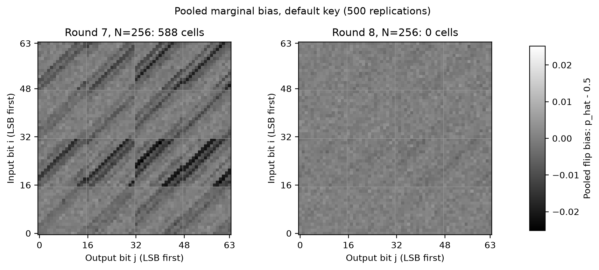
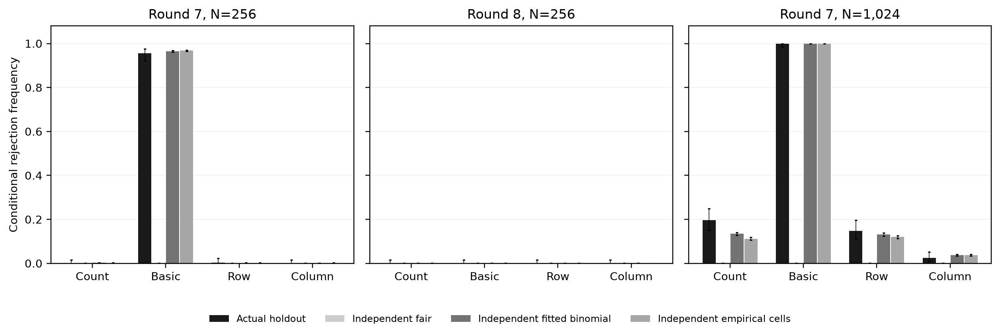
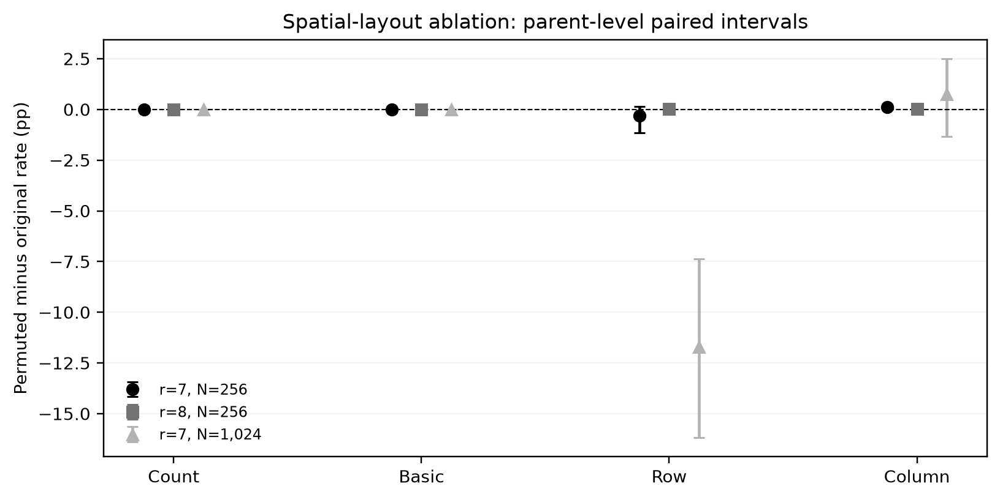

# Supplement to “Calibrated Strict Avalanche Criterion Comparisons Reveal Detector-Dependent Diffusion Endpoints”

This index accompanies the revised manuscript. A [standalone PDF](MANUSCRIPT_SUPPLEMENT.pdf) provides the same supplemental narrative and tables for journal upload. Experimental sources and data
retain their original hashes and execution commits. This document consolidates
definitions, complete contrast reporting and evidence locations; it does not
add cipher replications or replace historical outcomes. Links identify artifacts
within the repository; a pinned full-history clone supports exact reproduction.

## S1. Observation model, search layouts and auxiliary decision bounds

The primary archive is [reference data](../data/reference/). Bit zero is the
integer LSB. RECTANGLE rows occupy bits 0–15,16–31,32–47,48–63;
CLEFIA words are packed most-significant first; SPARKLE and Alzette words are
packed least-significant first. The methods are defined by the retained
[adapters](../MODEL2C/primitif.py), not by a renderer's byte order.
Input stars contain a uniform base plus all n one-bit neighbours. Trace
queries include key additions/whitening as documented; final ciphertext
finalization is checked separately.

Active input sets: RECTANGLE {0,16,32,48} and
{0,16,32,48,1,17,33,49} select one/two bit-slice columns; CLEFIA
{88,…,91}/{88,…,95} select four/eight bits of plaintext byte 4
(byte 0 is most significant); SPARKLE/Alzette use {0,…,3}/{0,…,7}
in the first low word. These fixed, simple layouts are reproducible restricted
probes, not optimized or exhaustive searches. Three differential patterns flip
the first active bit, all four active bits or all eight active bits.

Under independent output labels at distinct inputs, conditional on a base
label the neighbour XORs are independent uniform n-bit vectors, with a law
that does not depend on the base label. Disjoint stars therefore give iid
Bin(N,1/2) count cells. Star intersections have probability at most
C(N,2)(n+1)^2/2^n; permutation switching adds C(Q,2)/2^n,
Q=N(n+1). Their sum is bounded by Q^2/2^n. Coupling bounds changes of
event probability, so the capped bound is added to ideal-label test tails.
This proves a reference-model correction, not independence of actual cipher
coordinates or serial round outcomes.

For linear sign agreements use two-sided exact Bin(N,1/2) cell tails,
Bonferroni over n^2 single-bit input/output masks, and delta_L=min(1,N^2/2^n).
For K distinct k-bit input cosets, each output-coordinate XOR is fair under
labels. If M coordinates are zero in every coset, use
Pr[Bin(n,2^-K)>=M] + C(K,2)/2^(n-k) + C(K*2^k,2)/2^n,
capped at one. The correction includes duplicate cosets and label collisions.
A conservative alternative is n*2^-K/M plus the same correction (M>0).
The archive calls these ZS4/ZS8; “coset XOR-balance” identifies the tested
coordinate property more precisely than a full-state zero-sum construction.

Differential detection retains T>=3, where T is maximum full-output difference
multiplicity over three fixed differences, and requires
D*[C(N,3)/((2^n-3)(2^n-5)) + C(N,2)*2/2^n] < alpha,
D=3. For a fixed nonzero input difference, distinct unordered input pairs are
disjoint; after a first output pair fixes a difference, the next two pairs
match it with probabilities bounded by 1/(2^n-3) and 1/(2^n-5).
Union bounds cover all triples and D patterns. The second term covers repeated
unordered input pairs. The bound is for the event T>=3, not a tail estimate
indexed by every possible observed T. A T>=2 detector would need its own
derivation, frozen policy and multiplicity handling; it was not substituted.

The full derivations and historical policies remain in
[METHODOLOGY_ID.md](METHODOLOGY_ID.md) and [METHODS.md](METHODS.md).
Finalization, output entropy and Python timings are ancillary audits rather
than evidence establishing diffusion security.

## S2. Original horizon components and historical SAC comparison

The complete seed/key/policy component table is
[horizon_semua_aturan.csv](../data/reference/audit/horizon_semua_aturan.csv).
“margin_ronde” in historical summaries means the remaining observed window
R-H, not a cryptanalytic security margin. A dash/empty family horizon means
H_m=0. Alzette H=R=4 is right-censored. Slim shares big prefixes.

All seven historical Stage-B significant contrasts are shown below. The
historical policy is MC-calibrated histograms at alpha=0.001; Count uses its
corrected discrete rule. These results have unequal actual null sizes and are
not silently replaced by Stage C. Δ = comparator minus Count; b=Count-only,
c=comparator-only. Intervals are pointwise paired bootstrap, not simultaneous
post-selection coverage. Exact p-values remain in the source CSV.

| r | N | Comparator | b | c | Δ (pp) | 95% CI (pp) | p-Holm90 |
| --- | --- | --- | --- | --- | --- | --- | --- |
| 6 | 64 | Basic | 0 | 271 | 54.2 | [49.8, 58.4] | 4.64×10⁻⁸⁰ |
| 6 | 64 | Row | 45 | 204 | 31.8 | [26.2, 37.2] | 1.98×10⁻²³ |
| 6 | 64 | Column | 80 | 159 | 15.8 | [9.8, 21.6] | 3.04×10⁻⁵ |
| 7 | 64 | Basic | 0 | 112 | 22.4 | [18.8, 26.2] | 3.35×10⁻³² |
| 7 | 256 | Basic | 0 | 486 | 97.2 | [95.6, 98.6] | 9.01×10⁻¹⁴⁵ |
| 7 | 1,024 | Basic | 0 | 439 | 87.8 | [84.8, 90.6] | 1.25×10⁻¹³⁰ |
| 7 | 1,024 | Column | 54 | 19 | −7.0 | [−10.4, −3.8] | 4.25×10⁻³ |

The full two-cipher 30-condition grid, all 90 primary contrasts, Wilson
intervals, paired outcomes and 64-/128-bit null validation are in
[Stage-B data](../data/followup/sac_directed_2026-11-10/) and
[its protocol](../experiments/sac/README.md).
Both state widths are retained, including the historical 128-bit,N=256
Basic null rate 0.00123. Original coset detail, calibration and larger-sample
results remain in the reference folders.

## S3. Size-aware reanalysis and residual null mismatch

Three independent million-draw banks per N and one independent million-draw
validation per N give nine million training and three million held-out draws.
The Count-size-matched policy (archive identifier `match_count_nonrandom`) is primary; randomized α = 0.001 (`equal_alpha_randomized`) is sensitivity. Bank zero is primary and other banks measure retraining sensitivity. Validation is
shared across banks and never used to replace bank zero. Preserving nonrandom
Count targets its actual discrete size, but does not force each trained
histogram rule to have exactly that conditional size. The randomized policy
is separate and explicitly changes all detectors.

All six significant primary reanalysis contrasts follow (same definitions as
S2). Holm90 retains Stage B’s conservative family-size parameter M = 90 for the 45 ordered RECTANGLE p-values, with multipliers 90 − j + 1 and a running maximum capped at one. Historical
Column r6,N64 significance disappears after recalibration. The full 45 tested
rows, including non-significant results, are available in the linked data.

| r | N | Comparator | b | c | Δ (pp) | 95% CI (pp) | p-Holm90 |
| --- | --- | --- | --- | --- | --- | --- | --- |
| 6 | 64 | Basic | 0 | 271 | 54.2 | [49.8, 58.4] | 4.64×10⁻⁸⁰ |
| 6 | 64 | Row | 74 | 169 | 19.0 | [13.2, 24.8] | 8.70×10⁻⁸ |
| 7 | 64 | Basic | 0 | 79 | 15.8 | [12.6, 19.0] | 2.88×10⁻²² |
| 7 | 256 | Basic | 0 | 477 | 95.4 | [93.6, 97.2] | 4.61×10⁻¹⁴² |
| 7 | 1,024 | Basic | 0 | 439 | 87.8 | [85.0, 90.6] | 1.25×10⁻¹³⁰ |
| 7 | 1,024 | Column | 55 | 18 | −7.4 | [−10.6, −4.2] | 1.44×10⁻³ |

Bank-zero conditional null validation (each row has one million draws) is
shown for both primary histogram laws. Row and Column share the marginal
maximum-axis law, not joint decisions. Count null draws are simulated
separately; no cross-detector paired-null claim is made.

| N | Law | Count target | Observed null size | Wilson95 interval |
| --- | --- | --- | --- | --- |
| 64 | Basic | 0.000301282 | 0.000271 | [0.000240602, 0.000305237] |
| 64 | Maximum-axis | 0.000301282 | 0.000272 | [0.000241543, 0.000306297] |
| 256 | Basic | 0.000406803 | 0.000346 | [0.000311418, 0.000384421] |
| 256 | Maximum-axis | 0.000406803 | 0.000374 | [0.000337974, 0.000413865] |
| 1,024 | Basic | 0.000718038 | 0.0007 | [0.000650045, 0.000753791] |
| 1,024 | Maximum-axis | 0.000718038 | 0.000775 | [0.000722342, 0.000831493] |

All banks/policies and exact statistics are in
[size-matching evidence](../data/followup/sac_size_matched_2026-11-11/),
[interpretation](SAC_SIZE_MATCHING.md) and
[frozen protocol/reproduction](../experiments/sac_size/README.md).
Upper tails retain 5,000 order statistics, validation indices and count
boundary candidates. Full-array hashes and execution-time full/tail decision
checks include truncated tie groups. The portable verifier preserves frozen
source bytes and adapts only one floating-point target metadata comparison;
scientific decisions and integer/hash checks remain unchanged.

## S4. Independent inputs and limited random-key confirmation

The plan and full key list precede main measurements. Display keys K1–K8 map to archived identifiers random_01–random_08; Default maps to default. Nine keys comprise a
default control and eight randomly selected keys excluding historical keys;
all are retained irrespective of performance. Each key has 500 replications,
N=256/1024 and rounds 6–8. The 18 preselected contrasts have Holm18 control;
the complete grid has separate Holm162 control. No 4,000-input-replication
pooling is used to claim 4,000 independent keys. Intervals condition on key
and trained calibration; different keys have different input samples.

| Key | N | Comparator | Δ (pp) | 95% CI (pp) | p-Holm18 | p-Holm162 |
| --- | --- | --- | --- | --- | --- | --- |
| Default | 256 | Basic | 95.4 | [93.4, 97.2] | 7.69×10⁻¹⁴³ | 8.15×10⁻¹⁴² |
| Default | 1,024 | Column | −11.6 | [−15.0, −8.2] | 1.30×10⁻⁹ | 2.08×10⁻⁸ |
| K1 | 256 | Basic | 96.6 | [95.0, 98.2] | 1.36×10⁻¹⁴⁴ | 1.29×10⁻¹⁴³ |
| K1 | 1,024 | Column | −3.0 | [−6.2, 0.2] | 0.0912 | 1 |
| K2 | 256 | Basic | 95.4 | [93.4, 97.2] | 7.69×10⁻¹⁴³ | 8.15×10⁻¹⁴² |
| K2 | 1,024 | Column | −10.8 | [−14.4, −7.2] | 4.12×10⁻⁸ | 7.37×10⁻⁷ |
| K3 | 256 | Basic | 97.0 | [95.4, 98.4] | 3.60×10⁻¹⁴⁵ | 3.24×10⁻¹⁴⁴ |
| K3 | 1,024 | Column | −7.8 | [−11.4, −4.2] | 2.66×10⁻⁴ | 7.44×10⁻³ |
| K4 | 256 | Basic | 95.4 | [93.4, 97.2] | 7.69×10⁻¹⁴³ | 8.15×10⁻¹⁴² |
| K4 | 1,024 | Column | −6.2 | [−9.8, −2.6] | 3.05×10⁻³ | 0.139 |
| K5 | 256 | Basic | 94.6 | [92.4, 96.6] | 9.76×10⁻¹⁴⁰ | 1.50×10⁻¹³⁸ |
| K5 | 1,024 | Column | −8.8 | [−12.2, −5.2] | 1.11×10⁻⁵ | 2.25×10⁻⁴ |
| K6 | 256 | Basic | 95.2 | [93.2, 97.0] | 1.23×10⁻¹⁴² | 1.60×10⁻¹⁴¹ |
| K6 | 1,024 | Column | −6.6 | [−9.8, −3.4] | 5.67×10⁻⁴ | 0.0197 |
| K7 | 256 | Basic | 95.6 | [93.6, 97.2] | 4.10×10⁻¹⁴³ | 4.10×10⁻¹⁴² |
| K7 | 1,024 | Column | −5.4 | [−8.8, −2.0] | 6.37×10⁻³ | 0.433 |
| K8 | 256 | Basic | 94.8 | [92.8, 96.6] | 4.51×10⁻¹⁴² | 6.36×10⁻¹⁴¹ |
| K8 | 1,024 | Column | −8.2 | [−11.6, −4.8] | 3.39×10⁻⁵ | 7.98×10⁻⁴ |

See [all key evidence](../data/followup/sac_fresh_keys_2026-11-11/),
[frozen keys/protocol](../experiments/sac_confirm/), and
[confirmation interpretation](SAC_FRESH_KEYS.md). Zero duplicate/intersecting
bases concern bases only, not all neighbour queries. Raw statistics are
reconstructed from full value and axis-bin histograms; 72 native eight-round
snapshot traces are regenerated. Selected complete snapshots do not imply
every full matrix was originally retained.

## S5. Exploratory mechanism diagnostics

All 54 key/N/round metrics, 432 bin contributions, PMFs, coordinate maps,
surrogate rates, covariance decomposition and parent-clustered layout results
are in [mechanism data](../data/followup/sac_mechanism_2026-11-11/).
[SAC_MECHANISM.md](SAC_MECHANISM.md) explains them with four diagnostic figures;
the [frozen protocol](../experiments/sac_mechanism/) defines every seed and fit.

Mean Pearson equals histogram shape plus replication scatter exactly, using
the divisor L rather than L-1 for the descriptive variance. The empirical
independent scatter is sum(pi_ijb*(1-pi_ijb)/E_b); actual-minus-independent
scatter is signed net covariance. A small net term neither proves independent
coordinates nor quantifies how much detection power is explained.

For pooled coordinate totals T over M independent bases, unbiased squared
bias is ((T-M/2)^2-M/4)/(M*(M-1)). Negative estimates are retained;
averaging precedes the nonnegative square-root display. Pooled SAC marginal
tests have a fixed-map probability-1/2 null and a 221,184-coordinate
Bonferroni family. That family does not cover every adaptive project analysis.
They use 500 times one replication's budget and must not be presented as
per-replication ideal-permutation detection or perfect-SAC conclusions.

Three default cases are replayed from the existing inputs: N256/r7, N256/r8,
N1024/r7. All 3,000 original analyzed-round hashes are checked. Each surrogate
fits on 250 existing parents and is diagnosed against the other 250. There
are 90,000 synthetic matrices and 30,000 spatial permutations, not 120,000 new
cipher replications. Product-marginal models remove all cross-cell dependence;
they do not isolate a shared-base causal mechanism. Each of 250 parent matrices
has 40 permutations; bootstrap resamples parents. Rare parent outcomes and
omitted fit uncertainty limit intervals. The iid-fair 10,000-draw rate is a
diagnostic, not a replacement for million-draw null validation.

### Additional mechanism figures

## S6. Late decisions and ancillary audits

Across six original runs, six base traces and five corrected families, after
the corresponding combined H, excluding slim and the paired-CLEFIA view,
there are 1,770 decisions and three rejected positions: CLEFIA r13/r14 in
the larger run and SPARKLE256 step10 at seed2028. The CLEFIA pair is one
carried observable. Neither a naive count-times-alpha expectation nor failure
of confirmation identifies a particular outcome as a proven false positive.
The SPARKLE late signal has no dedicated confirmation.

The selected CLEFIA observable loses confirmation on 65,536 new inputs.
See [reference audit files](../data/reference/audit/) for the frozen
coordinates, confirmation and late decisions. Tie-aware Spearman,
within-primitive/without-slim descriptions, whitening/output entropy,
key-avalanche and scalar-Python timings are ancillary material retained in
the reference archive. Constant-series correlations are undefined and pooled
serial observations are not independent statistical evidence. Uniform inputs
stay uniform even under identity; output uniformity alone is not diffusion.

## S7. Implementation, provenance and reproduction

Official RECTANGLE/CLEFIA vectors and native scalar/batch checks are recorded
in regression tests. Official SPARKLE C v1.2.1 conformance, retained source,
license and permanent reports are indexed by
[SPARKLE_C_VALIDATION.md](SPARKLE_C_VALIDATION.md). Four builds reuse inputs;
slim shares prefixes. Finite agreement is not exhaustive conformance or
independently developed statistical replication. The old blocked Windows
attempt remains recorded separately from successful Linux execution.

[REPRODUCING.md](REPRODUCING.md) and experiment READMEs give commands and pinned
dependencies. A full-history clone is required for source-commit byte checks.
The four revised-manuscript figures can be regenerated with
`python -B experiments/plot_manuscript_figures.py` after installing
`experiments/sac_confirm/requirements.txt`. PNGs and script/input/output hashes
are written under ignored `results/manuscript-figures/`; no measurements are
changed. The reproducer emits script/input/output hashes for all four figures.
CI checks manifest integrity, regression, C conformance and retained SAC
inference, including native snapshots and mechanism diagnostics. It does not
regenerate all expensive training arrays or 4,500 full input replications.
[SHA256SUMS.json](../provenance/SHA256SUMS.json) protects intended repository
files. Original/follow-up protocol and execution commits are preserved.

The standalone PDF is rendered from this index and the linked diagnostic PNGs
with `scripts/render_supplement_pdf.py --fonts /path/to/Times-fonts`. This
document-only command requires ReportLab and locally supplied Times New Roman
font files; fonts are not distributed. It leaves all numerical measurements
unchanged.

Substantive AI assistance, validations and recorded model-identifier limits
are disclosed in [AI_ASSISTANCE.md](AI_ASSISTANCE.md).

## S8. Reporting checklist and scope of claims

For each empirical endpoint record:

1. Primitive/variant, native iteration unit and observed window.
2. State packing, finalization, key selection and access interface.
3. Observable, statistic, detector family and fixed search layout.
4. Base count, total trace-query budget and reuse/nesting.
5. Null model, finite-domain correction and measured conditional size.
6. Calibration training/validation separation and retraining sensitivity.
7. Multiplicity family, paired inference and conditional interval scope.
8. Endpoint definition, component support, late outcomes and censoring.
9. Selection versus new-input/key confirmation versus reused diagnostics.
10. Immutable repository version, source/data hashes and reproduction commands.

No optimal detector, causal cipher-layer attribution, new contiguous Basic
horizon, whole-key-space equivalence or full-round security claim is made.
