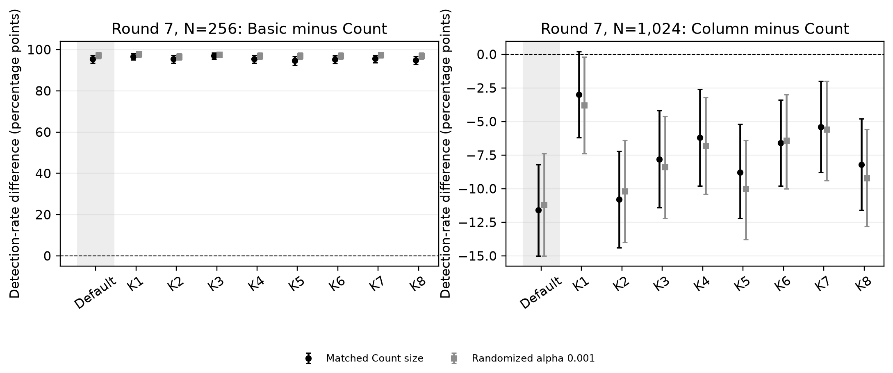

# Fresh-input and random-key SAC confirmation

Executed on 11 November 2026. The plan, complete key list and all execution,
analysis, plotting and verification tools were frozen before main input
generation in `71853e7dbf0a1dfccb4d80146f29a824ead217a4`. Targets were selected
from previous findings; confirmation inputs are new. Trained calibration is
reused unchanged, so input confirmation conditions on that fixed calibration.

RECTANGLE-80: one default control plus eight seed-selected random 80-bit keys,
500 fresh input replications per key, N=256/1024 nested prefixes, native rounds
6–8. Each detector sees the same SAC matrix and query budget. There are 4500
new cipher replications and no new null training/validation simulations.

Two preselected contrasts per key form the primary Holm18 family. The complete
162-contrast grid is retained with a separate Holm162 correction. Other
policies and calibration banks are sensitivity families, not extra independent
input samples. Per-key Wilson/paired-bootstrap intervals are pointwise and
conditional on key/bank. Random-key averages/ranges are descriptive; 4000 input
replications do not constitute 4000 sampled keys.

Under primary bank-zero size matching, the fresh default control gives:

- Round 7,N=256: Basic 478/500 versus Count 1/500,
  Basic-minus-Count 95.4 percentage points,
  paired-bootstrap 95% interval [93.4, 97.2],
  Holm18 p <10⁻¹⁰⁰; Holm162 p <10⁻¹⁰⁰.
- Round 7,N=1024: Count 75/500 versus Column 17/500,
  Column-minus-Count -11.6 points,
  interval [-15.0, -8.2],
  Holm18 p 1.3e-09; Holm162 p 2.08e-08.

Across eight random keys, the Basic-minus-Count mean difference is
95.6 points, range [94.6, 97.0];
8/8 point in the planned direction,
8/8 are significant under Holm18 and
8/8 under Holm162. Column-minus-Count
has range [-10.8, -3.0];
8/8 favor Count,
7/8 significantly under Holm18 and
5/8 under Holm162.

The primary Count–Column exception is K1: Count 9.8%, Column 6.8%, Holm18
p=0.0912. Its significance changes in some sensitivity policies/banks; the
relative advantage must not be described as uniformly significant. Average
random-key detection at N=1024 is only 12.6% for Count and 5.5% for Column.

All keys and failures/reversals/nonsignificant results remain in the archive.
No keys, thresholds or stopping rules were selected based on performance.
Keys exclude historical study keys and are selected solely by the frozen RNG
recipe. Different keys have independent input streams; observed between-key
variation includes finite-input sampling variation. Eight random key clusters
provide limited evidence about the full 80-bit key space.

Preflight scalar conformance covers all nine keys: 22,050 native states and
294,912 count-matrix elements. Main verification reconstructs all four
statistics from complete count-value/axis-bin histograms, verifies 9000 input
prefix hashes, recomputes paired inference, and regenerates 72 native count
trace snapshots, each containing eight rounds (216 analyzed-round matrix
conditions). Within-key base duplicates: 0; base intersections with
the 512000 discovery bases: 0. This checks bases, not every
one-bit-neighbor query. Original code/data and calibration bytes remain
unchanged. Matrix aggregates and selected snapshots support future mechanism
analysis, without claiming all full matrices have been archived.

The study does not identify a cryptographic mechanism or establish a new
contiguous horizon, full-round security claim, or behavior across all keys.
Conditional null-size mismatch from the previous calibration remains applicable.

See [protocol and reproduction](../experiments/sac_confirm/README.md),
[key list](../experiments/sac_confirm/keys.json),
[analysis summary](../data/followup/sac_fresh_keys_2026-11-11/analysis_summary.json),
[per-key rates](../data/followup/sac_fresh_keys_2026-11-11/detection_rates.csv),
[paired comparisons](../data/followup/sac_fresh_keys_2026-11-11/paired_comparisons.csv),
[random-key descriptions](../data/followup/sac_fresh_keys_2026-11-11/random_key_summary.csv),
and [verification](../data/followup/sac_fresh_keys_2026-11-11/verification.json).

