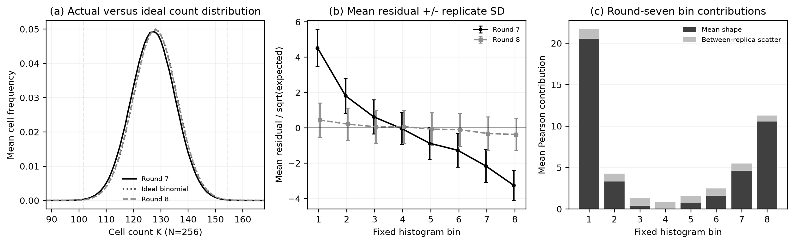
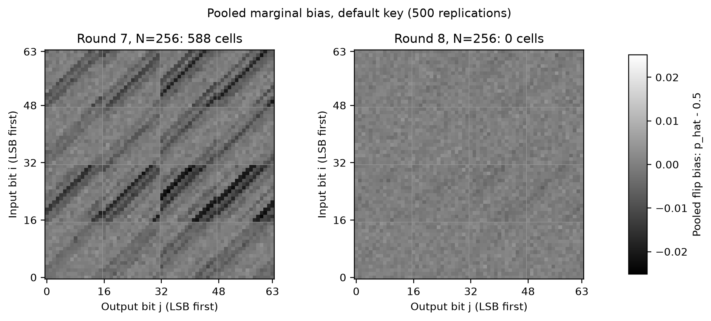
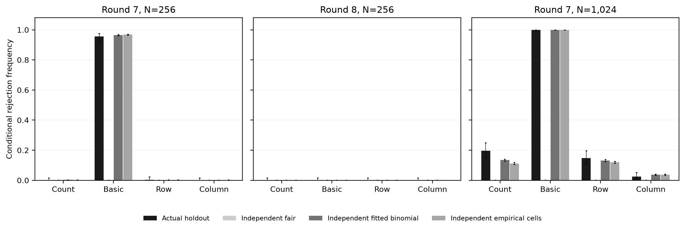
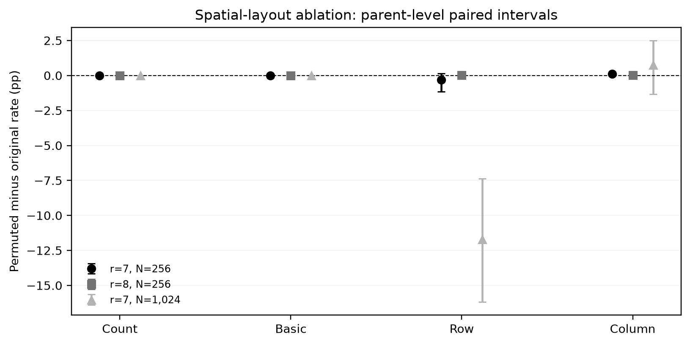

# Statistical mechanism of SAC-Basic detection

Exploratory analysis dated 11 November 2026. Statistical code/plan were frozen
in `6d60cfb6c84a4cc02717e1896ec0d19671f08693` before main mechanism outputs;
preflight used synthetic data. The existing nine-key confirmation archive is
reused across 54 conditions. Default matrices are replayed with all 3000
original matrix hashes checked; no new cipher input replications are added.

At RECTANGLE round 7,N=256, default-key mean flip probability is
0.49676041. Mean Basic is 48.985, comprising
41.789 mean-shape and 7.196 scatter contributions.
The net empirical cross-cell covariance contributes 0.291; this is a signed
contribution to the statistic's mean, not a measure of all dependence or a
fraction of power explained. Bins 1/8 contribute 67.3% of mean Basic.
Count averages 4.294 extreme cells, below its 12-cell threshold.

Pooled marginal SAC tests find 588 significant coordinates, all negative,
under a 0.05/221184 Bonferroni cutoff for this exploratory grid. These are
fixed-map marginal tests, distinct from the original ideal-permutation null;
they do not control all adaptive analyses across the project. Raw squared
bias is concentrated in input bits 16–31 and 48–63. Observed patterns do not
identify a particular cipher layer. Across nine keys, mean flip probability
ranges 0.49668441–0.49677040 and mean-shape fractions
85.3–86.4%.

Models fit on replicas 0–249 are compared with the existing holdout 250–499.
With cross-cell dependence removed, fitted-binomial and empirical-marginal
Basic rejection rates are 96.47% and 96.77%, versus 95.6% observed holdout.
This supports a marginal-distribution explanation at the default key; it is
not unique causal identification or independent new data confirmation.
Fitted-model intervals omit estimation uncertainty. Count is less well
predicted at N=1024 (13.44%/11.17% versus 19.60% observed), so the models
do not explain the complete joint behavior of every detector.
Synthetic count matrices need not correspond to any valid cipher.

Uniformly permuting cell positions preserves Basic and Count exactly.
For round 7,N=1024, Row falls from 14.8% to 3.10% and permuted Column is
3.15%, supporting an effect of spatial assignment on axis statistics.
Count remains 19.6%, so spatial rearrangement does not remove the entire
Count–Column difference; global-count versus maximum-axis aggregation remains
relevant.
Forty permutations per holdout matrix are clustered within 250 parent
replications. Intervals resample parents and are exploratory; rare parent
outcomes limit bootstrap interpretation. No ShiftRows/S-box cause follows.

Round 8,N=256 has mean Basic 7.486 near the iid reference 7.
At N=1024, pooled 500N marginal tests nevertheless detect 15 coordinates,
while per-replica Basic rejects 1/500. The pooled budget is 500 times larger;
non-detection is not perfect SAC, and no new contiguous horizon is defined.

There are 90000 synthetic surrogate matrices and 30000 layout permutations,
not 120000 new cipher replications. Fair-model tail counts at 10000 draws
do not replace the previous million-draw null validation. Product-marginal
models remove all cross-cell dependence without isolating shared-base effects.
Mean-shape departures may also be exploitable by other aggregate tests;
the analysis does not establish Basic as unique or optimal.

See [protocol/reproduction](../experiments/sac_mechanism/README.md),
[numeric interpretation](../data/followup/sac_mechanism_2026-11-11/interpretation.json),
[all condition metrics](../data/followup/sac_mechanism_2026-11-11/condition_metrics.csv),
[bin contributions](../data/followup/sac_mechanism_2026-11-11/bin_contributions.csv),
[surrogate results](../data/followup/sac_mechanism_2026-11-11/surrogate_summary.csv),
[layout results](../data/followup/sac_mechanism_2026-11-11/layout_summary.csv),
and [verification](../data/followup/sac_mechanism_2026-11-11/verification.json).

