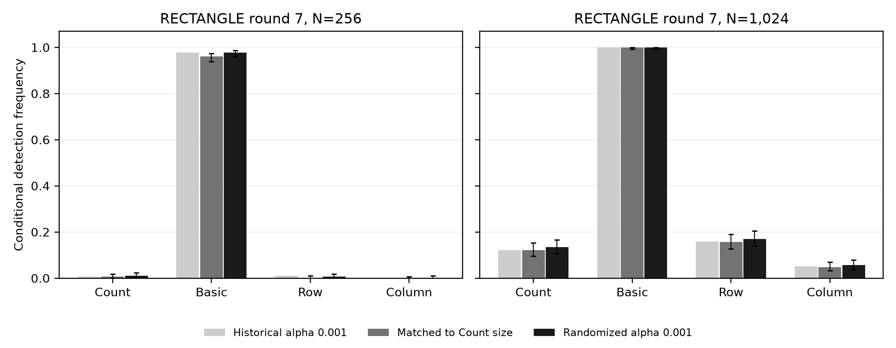
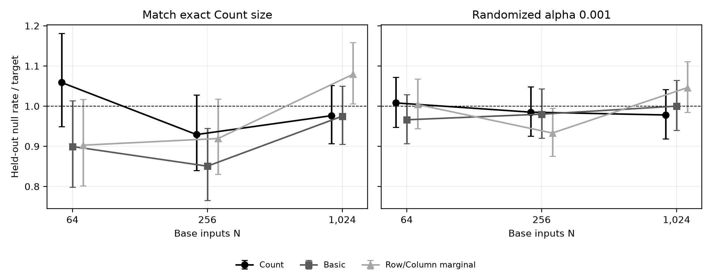

# Size-matched SAC reanalysis

Executed on 11 November 2026. The plan and execution tools were frozen in
`1e3b424da936cb148dc7b536c990cdfb36a36e4f` before the new null simulations.
The question was selected after inspecting the existing cipher data; this is
a post hoc sensitivity reanalysis, not an independent cipher replication.

The full archived RECTANGLE grid (15 conditions, 500 replications, one default
key) is reused without new cipher evaluations. Three independent million-draw
calibration banks per N give nine million training draws. One million new
held-out draws per N give three million validation draws. Bank zero is primary;
banks one and two assess retraining sensitivity and are never substitutes
selected by validation performance.

The primary policy preserves the exact nonrandom count rule and targets its
actual iid-label size for histogram tests. A secondary randomized policy
targets alpha=0.001 for every method. Randomizers are independent across methods
and replicate indices, and shared across banks/rounds as specified in the
protocol. Ideal-permutation coupling is retained. Actual conditional sizes are
validated and must not be called exactly equal.

Manuscript display names are **Count-size-matched** (primary, archived as
`match_count_nonrandom`) and **randomized α = 0.001** (sensitivity, archived as
`equal_alpha_randomized`). The archived identifiers and numerical results are
unchanged.

At round 7, N=256, primary Basic detects 480/500, versus Count
3/500; difference 95.4 percentage points,
pointwise paired-bootstrap 95% interval [93.6, 97.2],
Holm90 p <10⁻¹⁰⁰.
At round 7, N=1024, Count detects 61/500 and Column
24/500; Column-minus-Count difference -7.4
points, Holm90 p 0.00144.

The historical Column advantage at round 6, N=64 is not robust: Column
40.6% versus Count 45.8% under the primary policy, Holm90 p=1. The randomized
policy gives Column 62.2% versus Count 55.0%, also nonsignificant after Holm.
This loss of a smaller historical contrast must accompany the robust findings.

Residual conditional size mismatch remains. Primary bank-zero Basic at N=256
has held-out null rate 0.000346 versus exact count target 0.0004068; max-axis
at N=1024 has 0.000775 versus target 0.0007180. Some conditional intervals
exclude the target. Under the randomized N=256 policy, null rates are much
closer (Count 0.000985, Basic 0.000980), while detection is Basic 489/500 versus
Count 5/500. No validation-guided bank replacement or threshold tuning occurred.

6 of 45 primary RECTANGLE contrasts are significant. Holm retains
90 slots from the original two-cipher grid, assigning p=1 to 45 untested
CLEFIA contrasts. Other policies/banks are sensitivity analyses rather than
independent confirmations. All grids, paired outcomes, conditional intervals,
and actual null sizes are archived, including nonsignificant results.

The upper-tail sufficient records retain 5000 values per histogram law,
validation indices and the full count-frequency histogram. Complete-array
hashes and seeds permit full replay. Decision equivalence with full arrays is
checked at execution, including truncated-tie coverage. Row and Column share
the same marginal maximum-axis null law. Count draws are separate marginal
binomial draws: no cross-detector joint-null statement follows.

Pointwise Wilson/paired-bootstrap intervals condition on a trained bank and
do not integrate retraining uncertainty. Three banks describe an observed
range, not its full distribution. Fixed-key and reused-input limitations
remain, and the mechanism of the observed cipher departure is not identified.
CLEFIA size matching, key generalization and a new contiguous horizon are not
claimed. Original measurements and production cipher sources remain unchanged.

The post-generation plot renderer is separate from frozen statistical sources.
It clamps only microscopic negative errorbar extents caused by Wilson endpoint
roundoff at zero/one, leaving recorded intervals unchanged. Renderer, CSV and
figure hashes are retained in `plot_provenance.json`.

See [execution protocol and reproduction commands](../experiments/sac_size/README.md),
[analysis summary](../data/followup/sac_size_matched_2026-11-11/analysis_summary.json),
[paired comparisons](../data/followup/sac_size_matched_2026-11-11/paired_comparisons.csv),
[null validation](../data/followup/sac_size_matched_2026-11-11/null_validation.csv),
[bank sensitivity](../data/followup/sac_size_matched_2026-11-11/calibration_sensitivity.csv),
and [verification](../data/followup/sac_size_matched_2026-11-11/verification.json).

